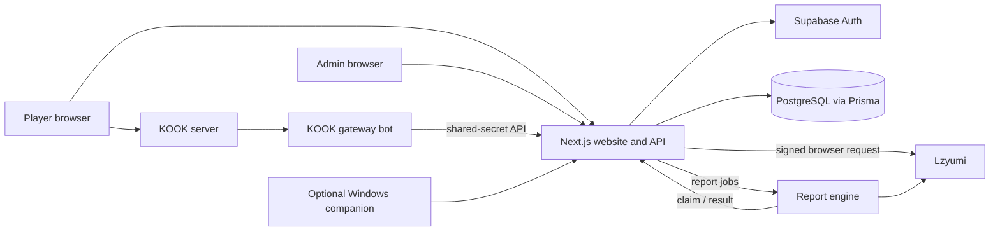

# ECL architecture

Last reviewed: 2026-11-13

## System boundary

The website/API and database are the ECL source of truth. External providers supply evidence and enrichment; they do not own ECL session, result, tournament, or LP state.

## Runtimes

| Runtime | Location | Responsibility |
| --- | --- | --- |
| Next.js web/API | repository root | Public site, authenticated Hub, admin UI, API contracts, domain orchestration, Prisma access |
| PostgreSQL/Prisma | `prisma/schema.prisma` | Durable ECL account, tournament, match, player, verification, session, and job state |
| Supabase Auth | external | Player authentication/session identity; mapped to `User` and `AccountProfile` |
| KOOK gateway bot | adjacent `ecl-kook-bot` repo | KOOK WebSocket connection, command parsing, voice/member operations, and message delivery |
| Report engine | `report-engine/` | Always-on match-discovery and confirmation-job polling, China-server lookup/detail collection, and final KOOK result delivery |
| Windows companion | `companion/` | Optional local client/data collection and desktop Hub experience; historical inhouse pilots used it for game-ID collection, but the current Lzyumi reporting path does not require it |

The report engine is deployed from `report-engine/` to the Railway service
`ECL Report Engine` in the `production` environment. The same Railway project
also contains `ecl-kook-bot`, but that service is owned by the adjacent
`ecl-kook-bot` repository and must not be deployed or configured from this
repository. Railway project, environment, and service IDs are operator-local
release inputs rather than source-controlled architecture; see `RUNBOOK.md`.

## Web layout boundaries

The App Router root layout owns only the global document, metadata, fonts, and body styling. The `(public)` route group owns the public header, mobile navigation, and footer, including the public `/hub` introduction. Hub application routes under `/hub/*` use the separate `(hub)` route-group layout, so the public chrome is absent from their rendered tree instead of being covered by the fixed Hub surface.

The Hub route-group layout owns one client `HubBootstrapProvider`. It registers one Supabase auth subscription for the mounted Hub tree, resolves the initial session once, and loads only the profile fields needed to distinguish a missing profile from an available profile. `HubAccessGate` and route clients consume that shared state; route-specific profile, tournament, reporting, and other domain reads remain separate.

The authenticated account-profile API uses explicit screen projections. Profile receives identity, presentation fields, and only the snapshot fragments that its UI renders; Settings receives editable account fields and the latest KOOK verification state without `openId` or raw Lzyumi snapshots. Tournament application and inhouse reporting use smaller purpose-specific projections. A missing profile remains distinct from a timed-out or failed request so Profile and Settings can leave their bounded skeleton state and offer a retry.

This client bootstrap controls presentation only. It is not an authorization boundary: every private API/server data boundary continues to validate the bearer session and its resource-specific permissions independently. Public routes are outside the Hub provider.

## Domain ownership

| Data | Owner | Notes |
| --- | --- | --- |
| Login session | Supabase Auth | Never infer authorization from a submitted email/display name |
| ECL profile and privacy | ECL database | `AccountProfile` is the account-facing profile |
| Competitive player/LP | ECL database | `Player` and game-stat records drive the ECL ladder |
| Riot China identity/rank/history snapshot | ECL database, verified from Lzyumi | Store provenance/freshness with the exact identity |
| KOOK linkage | ECL database | Stable KOOK ID is authoritative; username is mutable metadata |
| Inhouse session/roster | ECL database | Frozen at ready time and used during report validation |
| Match result/player stats/LP | ECL database | Must commit atomically and idempotently |
| Tournament state | ECL database | Event-specific policy is configuration/documentation, not provider state |

## Core flows

### Authenticated profile refresh

1. The route-specific account profile request returns the last stored coherent snapshot, which renders before any stale-data refresh completes.
2. On the authenticated user's own profile path, a stale or missing snapshot causes the browser to ask `/api/lzyumi-sign` for short-lived signed provider URLs in the background. Opening another player's public profile never enters this implicit refresh flow; it renders only the last verified snapshot and timestamp.
3. The browser calls Lzyumi from the player's residential IP.
4. Filter `1` supplies identity/profile/rank; `2` Solo/Duo history; `3` Flex history.
5. The application verifies full Riot ID, China server, and `openId` before accepting a snapshot.
6. A complete validated replacement is saved and then replaces the visible snapshot atomically. Optional recent champion statistics may fail without invalidating valid identity/rank data; their stale values must not survive as if refreshed. A failed required refresh leaves the prior snapshot and successful timestamp visible and unchanged.

### KOOK inhouse lifecycle

1. The adjacent bot reads KOOK events and voice membership.
2. It calls shared-secret `/api/kook/*` endpoints; the web layer validates identities and persists the session.
3. The bot performs KOOK-native actions such as messages and voice moves from returned instructions.
4. After play, the web app creates an `InhouseReportJob` for the worker.
5. The worker claims a job, queries the configured provider, and returns a candidate with raw evidence.
6. A player confirms the preview with `!yes`; the web API records a durable confirmation job and returns promptly to the KOOK gateway.
7. The report engine claims the confirmation job and submits the saved candidate back to the web API with its worker credential.
8. The web API revalidates authorization, roster, time window, provider identity, and deduplication, then commits the match, statistics, session completion, and LP effects atomically and idempotently.
9. KOOK delivery happens after the durable commit. Delivery failure must not revert or disguise completed ECL state; it is an operational retry concern.

### Tournament lifecycle

Tournament routes and library modules own registrations, identity checks, rosters, fixtures, reports, notifications, and collection jobs. The tournament database models are separate from the older general `Team`/`Match` models, so code must be explicit about which competition model it is changing.

## Trust boundaries

- Browser input, KOOK messages, provider payloads, and companion uploads are untrusted until validated.
- Supabase authentication is not admin authorization.
- KOOK and worker endpoints require their configured shared secret; missing secrets must fail closed.
- Shared-secret service calls authenticate the service, not every business action. The API must still validate the acting KOOK ID, session membership, admin override, and resource state.
- Lzyumi/WeGame payloads must be structurally validated and bound to the expected Riot identity and server.
- Raw provider data and contact fields are private operational data unless explicitly projected into a public view.

## Known structural risks

These are current code risks, not desired architecture:

- The ranked-inhouse confirmation path protects its durable result with a transaction, deduplication, and an advisory lock. Other legacy result/stat/LP endpoints may still perform separate writes and retain partial-write or retry risk; continue tracking the broader atomicity work in GitHub issue #3.
- There is no committed Prisma migration history; track it in issue #4.
- The repository has no committed CI workflow; track the cross-runtime checks in issue #5.
- Admin auth currently contains fallback credentials and compares a raw shared value in the cookie. Several write/read exposure concerns are grouped in security issue #13.
- `report-engine/` currently has no lockfile, reducing reproducibility and supply-chain reviewability.
- The repo includes overlapping generations of tournament, match reporting, and desktop workflows. Do not consolidate them without data and rollout analysis.

## Change rule

New features should enter through an explicit domain/API boundary instead of adding direct Prisma writes in UI components or putting business rules in the KOOK gateway. A change that affects durable state must specify authorization, validation, transaction/idempotency behavior, failure recovery, observability, and a focused test.
