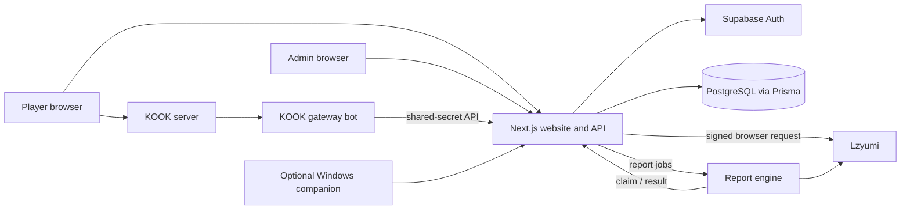

# ECL architecture

Last reviewed: 2026-11-07

## System boundary

The website/API and database are the ECL source of truth. External providers supply evidence and enrichment; they do not own ECL session, result, tournament, or LP state.

## Runtimes

| Runtime | Location | Responsibility |
| --- | --- | --- |
| Next.js web/API | repository root | Public site, authenticated Hub, admin UI, API contracts, domain orchestration, Prisma access |
| PostgreSQL/Prisma | `prisma/schema.prisma` | Durable ECL account, tournament, match, player, verification, session, and job state |
| Supabase Auth | external | Player authentication/session identity; mapped to `User` and `AccountProfile` |
| KOOK gateway bot | adjacent `ecl-kook-bot` repo | KOOK WebSocket connection, command parsing, voice/member operations, and message delivery |
| Report engine | `report-engine/` | Always-on job polling and China-server match lookup/detail collection |
| Windows companion | `companion/` | Optional local client/data collection and desktop Hub experience; not required for ordinary signed-browser profile refreshes |

## Domain ownership

| Data | Owner | Notes |
| --- | --- | --- |
| Login session | Supabase Auth | Never infer authorization from a submitted email/display name |
| ECL profile and privacy | ECL database | `AccountProfile` is the account-facing profile |
| Competitive player/LP | ECL database | `Player` and game-stat records drive the ECL ladder |
| Riot China identity/rank/history snapshot | ECL database, verified from Lzyumi | Store provenance/freshness with the exact identity |
| KOOK linkage | ECL database | Stable KOOK ID is authoritative; username is mutable metadata |
| Inhouse session/roster | ECL database | Frozen at ready time and used during report validation |
| Match result/player stats/LP | ECL database | Must commit atomically and idempotently |
| Tournament state | ECL database | Event-specific policy is configuration/documentation, not provider state |

## Core flows

### Authenticated profile refresh

1. The authenticated browser asks `/api/lzyumi-sign` for a short-lived signed provider URL.
2. The browser calls Lzyumi from the player's residential IP.
3. Filter `1` supplies identity/profile/rank; `2` Solo/Duo history; `3` Flex history.
4. The application verifies full Riot ID, China server, and `openId` before accepting a snapshot.
5. A complete validated replacement is saved. Optional recent champion statistics may fail without invalidating valid identity/rank data; their stale values must not survive as if refreshed.

### KOOK inhouse lifecycle

1. The adjacent bot reads KOOK events and voice membership.
2. It calls shared-secret `/api/kook/*` endpoints; the web layer validates identities and persists the session.
3. The bot performs KOOK-native actions such as messages and voice moves from returned instructions.
4. After play, the web app creates an `InhouseReportJob` for the worker.
5. The worker claims a job, queries the configured provider, and returns a candidate with raw evidence.
6. A player confirms the preview; the web API revalidates authorization, roster, time window, and deduplication before writing the result.

### Tournament lifecycle

Tournament routes and library modules own registrations, identity checks, rosters, fixtures, reports, notifications, and collection jobs. The tournament database models are separate from the older general `Team`/`Match` models, so code must be explicit about which competition model it is changing.

## Trust boundaries

- Browser input, KOOK messages, provider payloads, and companion uploads are untrusted until validated.
- Supabase authentication is not admin authorization.
- KOOK and worker endpoints require their configured shared secret; missing secrets must fail closed.
- Shared-secret service calls authenticate the service, not every business action. The API must still validate the acting KOOK ID, session membership, admin override, and resource state.
- Lzyumi/WeGame payloads must be structurally validated and bound to the expected Riot identity and server.
- Raw provider data and contact fields are private operational data unless explicitly projected into a public view.

## Known structural risks

These are current code risks, not desired architecture:

- Match-game player-stat creation and `Player` LP/streak updates occur as separate writes in current endpoints. This leaves partial-write and retry risk; track the atomicity work in GitHub issue #3.
- There is no committed Prisma migration history; track it in issue #4.
- The repository has no committed CI workflow; track the cross-runtime checks in issue #5.
- Admin auth currently contains fallback credentials and compares a raw shared value in the cookie. Several write/read exposure concerns are grouped in security issue #13.
- `report-engine/` currently has no lockfile, reducing reproducibility and supply-chain reviewability.
- The repo includes overlapping generations of tournament, match reporting, and desktop workflows. Do not consolidate them without data and rollout analysis.

## Change rule

New features should enter through an explicit domain/API boundary instead of adding direct Prisma writes in UI components or putting business rules in the KOOK gateway. A change that affects durable state must specify authorization, validation, transaction/idempotency behavior, failure recovery, observability, and a focused test.
